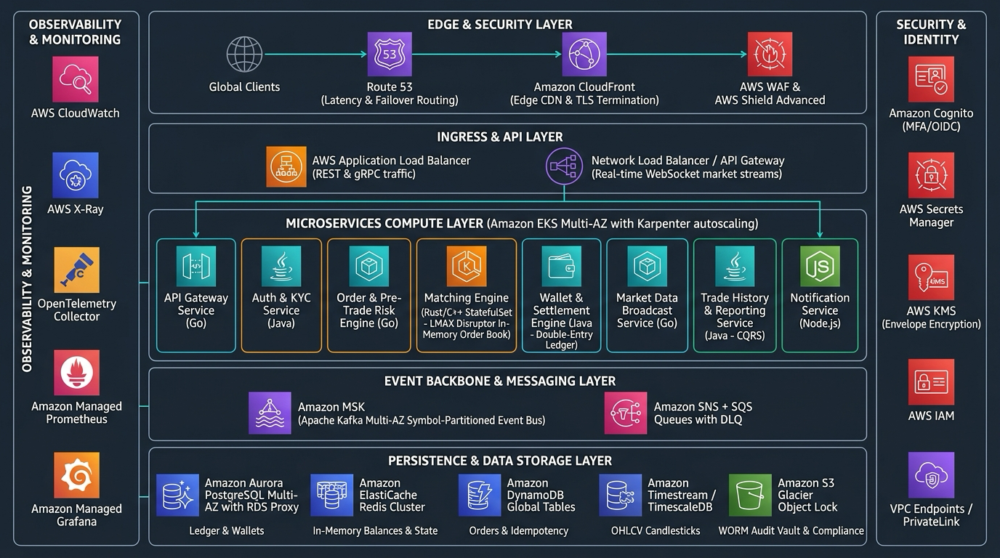
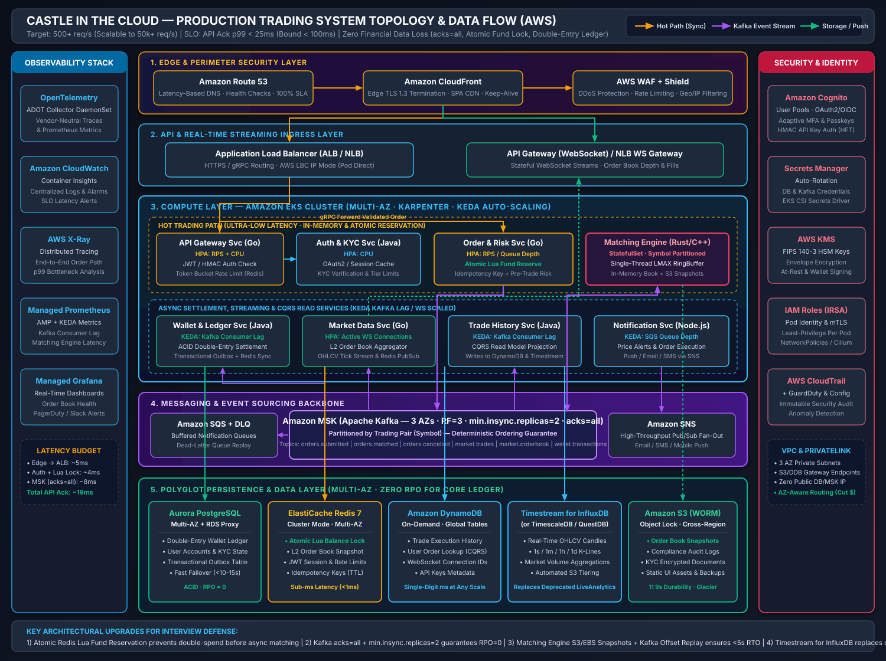
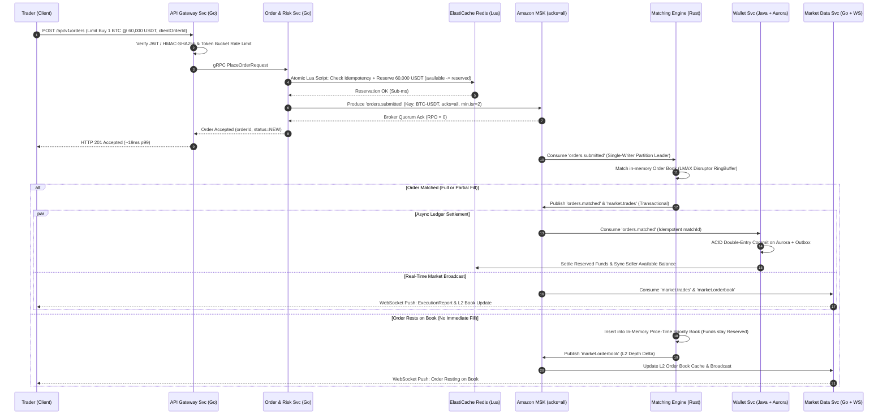

# Castle In The Cloud — Highly Available Trading System on AWS

## Challenge Overview

This architecture document outlines the design for a highly available, scalable, and cost-effective cryptocurrency spot trading platform (similar to Binance) on **AWS**. The system is engineered to handle **500 requests per second** (with burst capacity to 5,000+ req/s) at a **p99 response time under 100ms** (`~19ms` expected API acknowledgement), while enforcing **strict financial consistency (zero double-spend, `RPO = 0` for accepted orders, double-entry ledger auditability)**.

### Constraints & SLO Recap

| Parameter | Target / Constraint | Architectural Design Guarantee |
|-----------|---------------------|--------------------------------|
| **Cloud Provider** | **AWS** (`us-east-1` Multi-AZ) | 3 Availability Zones (`us-east-1a`, `1b`, `1c`) with zero single points of failure |
| **Throughput** | **500 req/s** baseline | Horizontally partitioned by trading pair; single shard handles 20,000+ orders/s |
| **Response Time** | **p99 < 100ms** | **~19ms API Ack p99** (`~26ms` E2E match) via in-memory hot path & async settlement |
| **Financial Durability** | **Zero Data Loss (`RPO = 0`)** | Atomic Pre-Trade Fund Reservation + Kafka `acks=all` (`min.insync.replicas=2`) + Aurora ACID Double-Entry Ledger |

---

## 1 — Selected Features to Demonstrate

> [!IMPORTANT]
> Rather than superficially listing every product on Binance, this design selects the **6 core architectural pillars** of a modern exchange that demonstrate **ultra-low-latency state machines, ACID financial ledgers, high-fanout real-time streaming, and multi-AZ fault tolerance**.

| # | Feature | Architectural Significance |
|---|---------|----------------------------|
| 1 | **User Authentication, KYC & API Keys** | Edge security, OAuth2/OIDC + MFA for retail users, low-latency HMAC-SHA256 API key validation for algorithmic traders |
| 2 | **Pre-Trade Risk & Atomic Fund Reservation** | Prevents double-spending and resting-order overdrafts on the critical path (`< 2ms`) before orders enter the matching queue |
| 3 | **Spot Trading (LMAX-Style Matching Engine)** | Core stateful business logic, deterministic price-time priority (FIFO), in-memory order book with snapshot + Kafka delta recovery |
| 4 | **Real-Time Order Book & Market Data Streams** | High-throughput WebSocket fan-out, L2 depth snapshots, and real-time OHLCV (K-line) candlestick aggregation |
| 5 | **Wallet & Double-Entry Settlement Ledger** | ACID financial settlement, Transactional Outbox pattern, idempotent event consumers, and cold/hot wallet separation |
| 6 | **Trade History, Reporting & Price Alerts** | CQRS read projections, time-series analytics, and asynchronous multi-channel notifications (SNS/SQS) |

---

## 2 — System Architecture & Topology

### High-Level Architecture Overview



### Detailed Service Topology & Data Flow



---

## 3 — Service-by-Service Breakdown & Alternatives Considered

### 3.1 Edge & Perimeter Security Layer

| Service | Role in System | Why This Choice | Alternatives Considered |
|---------|----------------|-----------------|-------------------------|
| **Amazon Route 53** | Authoritative DNS with latency-based routing and automated health checks | 100% availability SLA, native integration with CloudFront/ALB, supports DNS failover for DR | **Cloudflare DNS** — fast global anycast, but adds external control-plane dependency outside AWS IAM/Terraform |
| **Amazon CloudFront** | Global CDN for web/mobile static assets, edge TLS 1.3 termination, persistent origin keep-alive connections | Terminates TLS at edge PoPs closest to traders (saving 2–3 TCP/TLS RTTs), routes dynamic API traffic over the AWS global backbone | **AWS Global Accelerator** — great for raw TCP/UDP and non-HTTP protocols (adopted in Phase 3 for FIX/binary HFT connections), higher base cost for Phase 1 |
| **AWS WAF & Shield** | L7 rate limiting, IP reputation filtering, SQLi/XSS protection, DDoS mitigation | Protects API endpoints from credential stuffing and volumetric order spam before hitting EKS | **Self-managed Nginx/ModSecurity** — high operational overhead and scales poorly during volumetric L7 attacks |

### 3.2 API & Real-Time Streaming Ingress Layer

| Service | Role in System | Why This Choice | Alternatives Considered |
|---------|----------------|-----------------|-------------------------|
| **Application Load Balancer (ALB)** | L7 HTTP/HTTPS & gRPC ingress routing to EKS pods via AWS Load Balancer Controller (`ip` target mode) | Routes directly to Pod IPs (bypassing `kube-proxy` extra hop), native WAF & Cognito integration, supports gRPC | **Kong / Envoy on NLB** — slightly lower L7 proxy latency (`~1ms` gain) and richer plugin ecosystem, but requires managing proxy pods in Phase 1 |
| **NLB / API Gateway (WebSocket Ingress)** | Manages persistent WebSocket connections for real-time L2 order book depth, ticker streams, and execution reports | **Hybrid Design**: At 500 req/s with thousands of market-data subscribers, routing WebSocket connections through **ALB/NLB to stateful Go `Market Data Service` pods** enables local in-memory broadcast (`O(1)` per pod via Redis Pub/Sub). **API Gateway WebSocket** is supported for low-volume user-specific private notifications | **Pure API Gateway WebSocket for Market Data** — *Rejected for public market streams* because it lacks native topic broadcast (requiring `O(N)` individual HTTP `POST @connections` calls per tick) and incurs massive per-message billing at billions of ticks/month |

### 3.3 Compute Layer — Amazon EKS

| Service | Role in System | Why This Choice | Alternatives Considered |
|---------|----------------|-----------------|-------------------------|
| **Amazon EKS (Multi-AZ + Karpenter + KEDA)** | Container orchestration for stateless and stateful microservices across 3 AZs | Supports **Karpenter** for rapid Graviton3 (`m7g`/`c7g`) node provisioning, **KEDA** for scaling consumers on Kafka lag, **Pod Disruption Budgets (PDB)**, and **Topology Aware Routing** to keep traffic intra-AZ | **ECS Fargate** — higher per-vCPU cost, no daemonset/kernel tuning, slower scaling; **AWS Lambda** — cold starts and stateless invocation model violate `< 100ms` p99 and in-memory order book requirements |

#### Microservice Inventory & Scaling Strategy

| Microservice | Tech Stack | Deployment & Scaling Strategy | Architectural Responsibility |
|--------------|------------|-------------------------------|------------------------------|
| **API Gateway Service** | **Go** | Stateless Deployment · HPA on RPS & CPU | Validates JWT/HMAC-SHA256 signatures, enforces per-user token-bucket rate limits (Redis), routes via internal gRPC |
| **Auth & KYC Service** | **Java (Spring Boot)** | Stateless Deployment · HPA on CPU | Integrates with Cognito for login/MFA, manages KYC verification tiers, API key issuance, and withdrawal whitelists |
| **Order & Risk Service** | **Go** | Stateless Deployment · HPA on RPS | Validates trading rules (tick size, lot size, min notional), executes **Atomic Lua Fund Reservation** in Redis, writes idempotency keys, and publishes to `orders.submitted` |
| **Matching Engine** | **Rust / C++** | **StatefulSet** · Partitioned 1:1 by Symbol Shard | **Ultra-low-latency core**: Single-threaded **LMAX Disruptor** lock-free ring buffer per symbol partition; maintains in-memory order book; emits deterministic match events |
| **Wallet & Settlement Service** | **Java** | Stateless Deployment · **KEDA on Kafka Lag** | Consumes `orders.matched` and `orders.cancelled`; executes **ACID Double-Entry Ledger** transfers on Aurora PostgreSQL (`BigDecimal` exact math); updates Redis balances via **Transactional Outbox** |
| **Market Data Service** | **Go** | Stateless Deployment · HPA on Active WS Connections | Consumes `market.trades` and `market.orderbook`; aggregates real-time L2 depth & OHLCV candlesticks; broadcasts to connected WebSocket clients |
| **Trade History Service** | **Java** | Stateless Deployment · **KEDA on Kafka Lag** | CQRS read-model projection: consumes trade/order events and batch-writes into DynamoDB (user trade history) and Timestream for InfluxDB (K-line charts) |
| **Notification Service** | **Node.js (TypeScript)** | Stateless Deployment · **KEDA on SQS Depth** | Processes asynchronous price alerts, order fill emails, and mobile push notifications via SNS/SQS |

### 3.4 Event Backbone & Messaging Layer

| Service | Role in System | Why This Choice | Alternatives Considered |
|---------|----------------|-----------------|-------------------------|
| **Amazon MSK (Apache Kafka)** | Central event-sourcing backbone and deterministic sequencer for orders, trades, and market data | Guarantees **strict ordering per partition** (partitioned by `symbol`, e.g., `BTC-USDT`), high throughput (`< 8ms` p99 with `acks=all`), consumer group isolation, and offset replay for state recovery | **Amazon Kinesis Data Streams** — higher p99 latency (`~20–50ms`), limited consumer fan-out (2 MB/s per shard without EFO); **RabbitMQ / SQS** — destroys log replayability and multi-consumer deterministic ordering |
| **Amazon SNS + SQS (with DLQ)** | Decoupled fan-out and buffered delivery for non-critical path notifications (emails, SMS, push alerts) | Zero operational overhead, native Dead-Letter Queue (DLQ) support for failed third-party webhook/email deliveries | **Publishing notifications through core MSK** — pollutes core trading brokers with slow external I/O retry loops |

#### Kafka Topic & Durability Design

- **Durability Configuration (Financial-Grade)**: `replication.factor = 3` (across 3 AZs), `min.insync.replicas = 2`, Producer `acks = all` (`-1`), `enable.idempotence = true`.
- **Cost & Latency Optimization**: Enable **MSK Rack Awareness (`client.rack`)** so downstream consumers fetch from the local-AZ replica, eliminating Cross-AZ data transfer charges ($0.02/GB).

```text
orders.submitted       [Key: symbol]  → Order & Risk Service  → Matching Engine
orders.matched         [Key: symbol]  → Matching Engine       → Wallet Service, Trade History, Market Data
orders.cancelled       [Key: symbol]  → Matching Engine       → Wallet Service (unlock funds), Notification
market.trades          [Key: symbol]  → Matching Engine       → Market Data Service (real-time ticker & OHLCV)
market.orderbook       [Key: symbol]  → Matching Engine       → Market Data Service (L2 depth deltas)
wallet.transactions    [Key: user_id] → Wallet Service        → Notification Service, Compliance Audit
```

### 3.5 Polyglot Persistence & Data Layer

| Service | Role in System | Why This Choice | Alternatives Considered |
|---------|----------------|-----------------|-------------------------|
| **Amazon Aurora PostgreSQL (Multi-AZ + RDS Proxy)** | System of record for user accounts, **Double-Entry Wallet Ledger**, and Transactional Outbox | ACID compliance, 6 storage copies across 3 AZs (`RPO = 0`), **RDS Proxy** reduces failover time to `< 10–15s` and prevents connection exhaustion during EKS pod scaling | **Standard RDS PostgreSQL** — slower failover (`60–120s`) because standby is passive and requires storage sync; **CockroachDB / Spanner** — unnecessary cost/latency at 500 req/s |
| **Amazon ElastiCache for Redis (Cluster Mode)** | **Atomic Lua Pre-Trade Balance Reservation**, L2 order book snapshot cache, JWT session store, rate limiting, and idempotency keys | Sub-millisecond latency (`< 1ms`), single-threaded atomic Lua script execution prevents race conditions on balance locks, Multi-AZ auto-failover | **Amazon MemoryDB for Redis** — durable multi-AZ transaction log (great alternative if Redis is the sole primary store, though higher write latency `~2–4ms`); **Memcached** — no Lua scripting, persistence, or pub/sub |
| **Amazon DynamoDB** | CQRS read store for user order history, trade execution logs, idempotency lookup, and API key metadata | Predictable single-digit millisecond reads/writes at any scale; Partition Key `user_id`, Sort Key `timestamp#order_id` | **Querying Aurora directly for historical trades** — degrades primary ledger DB performance under heavy pagination/reporting queries |
| **Amazon Timestream for InfluxDB (or TimescaleDB)** | Stores OHLCV candlestick (K-line) time-series data (`1s`, `1m`, `5m`, `1h`, `1d`) and exchange telemetry | **Modern AWS Best Practice**: Replaces legacy *Timestream for LiveAnalytics* (closed to new customers in 2025). High-ingestion columnar storage with automated S3 tiering | **TimescaleDB on Aurora PostgreSQL** or **QuestDB / ClickHouse on EKS** — excellent portable open-source alternatives with zero vendor lock-in |
| **Amazon S3 (with Object Lock / WORM)** | Matching Engine order book snapshots, immutable compliance audit logs, KYC documents, and static UI assets | `99.999999999%` (11 9s) durability; **S3 Object Lock (WORM)** satisfies financial regulatory requirements against log tampering; Glacier lifecycle tiering | **EBS / EFS** — higher cost per GB and lacks native WORM compliance locking |

### 3.6 Security, Identity & Observability Stack

| Category | Services Used | Architectural Justification & Alternatives |
|----------|---------------|--------------------------------------------|
| **Identity & Access** | **Amazon Cognito**, **IAM Roles for Service Accounts (IRSA / Pod Identity)** | Managed OAuth2/OIDC with Adaptive MFA for retail users; IRSA enforces least-privilege AWS API access per Kubernetes Pod without static IAM keys (vs. self-hosted **Keycloak** which adds DB/ops overhead). |
| **Secrets & Encryption** | **AWS Secrets Manager**, **AWS KMS** | Automatic credential rotation for Aurora/MSK; FIPS 140-3 KMS HSM envelope encryption for PII and wallet state (vs. self-managed **HashiCorp Vault** cluster). |
| **Observability** | **OpenTelemetry (ADOT)**, **CloudWatch**, **AWS X-Ray**, **Managed Prometheus (AMP) & Managed Grafana (AMG)** | Vendor-neutral OpenTelemetry instrumentation exports metrics to AMP (driving KEDA autoscaling) and traces to X-Ray for end-to-end latency profiling, at `< 25%` the cost of **Datadog** or self-managed **ELK**. |

---

## 4 — Architecture Deep Dive: Order Lifecycle & Financial Consistency

### Solving the "Double-Spend" & "Latency vs. Durability" Problem

A common flaw in naive exchange designs is checking a user's balance in Redis (`GET balance`), publishing the order to Kafka, and only debiting the database *after* the order matches. That creates two fatal vulnerabilities:
1. **Concurrent Race Condition (TOCTOU)**: A trader sends 50 parallel orders in `1ms`; all 50 pass the read check before any match occurs.
2. **Resting Limit Order Overdraft**: A trader places a limit buy order below market price; if funds aren't locked while the order rests on the book, the trader can place infinite resting orders with the same balance.

#### Our Solution: Atomic Pre-Trade Reservation + Asynchronous Double-Entry Settlement

1. **Idempotency & Atomic Reservation (`< 2ms`)**:
   - The `Order & Risk Service` executes a single **atomic Redis Lua script** on the user's hash slot (`wallet:{user_id}`):
     - Checks if `client_order_id` already exists (idempotency check).
     - Verifies `available_balance >= required_amount`.
     - Atomically decrements `available_balance` and increments `reserved_balance` (`available -= amount`, `reserved += amount`), recording the reservation entry.
2. **Durable Event Sequencing (`~6–8ms`)**:
   - The order is published to MSK topic `orders.submitted` partitioned by `symbol` (`BTC-USDT`) with `acks=all` and `min.insync.replicas=2`. Once 2 brokers across different AZs acknowledge the write, the API immediately returns `201 Accepted` to the trader (`~19ms` total p99).
3. **Lock-Free In-Memory Matching (`< 1ms`)**:
   - The symbol's single-threaded **Matching Engine (Rust)** consumes `orders.submitted` in strict offset order, matches against its in-memory B-Tree / SkipList order book, and emits `orders.matched` (or `market.orderbook` if resting) within a Kafka transaction.
4. **ACID Ledger Settlement & Outbox (`Async`)**:
   - `Wallet Service` consumes `orders.matched`, executes an **ACID Double-Entry Ledger** transaction in Aurora PostgreSQL (debiting buyer's `reserved_balance`, crediting seller's `available_balance`, and recording exchange fees), and updates Redis via a **Transactional Outbox** worker. If an order is cancelled (`orders.cancelled`), reserved funds are atomically released back to `available_balance`.



### Latency Budget Breakdown (`p99 < 100ms` Target)

| Path Segment | Expected p50 | Expected p99 | Architectural Mechanism |
|--------------|--------------|--------------|-------------------------|
| **1. Client → CloudFront → ALB** | `1.5ms` | `5.0ms` | TLS 1.3 edge termination, persistent HTTP/2 keep-alive over AWS backbone |
| **2. ALB → API Gateway Service (Go)** | `0.5ms` | `1.5ms` | AWS Load Balancer Controller `ip` mode (direct to Pod IP, same AZ) |
| **3. Auth & Rate Limit Check (Redis)** | `0.4ms` | `1.0ms` | Local JWT public-key verification + pipelined Redis rate-limit check |
| **4. Order Validation & Atomic Fund Lock** | `1.0ms` | `2.5ms` | Internal gRPC hop + atomic Redis Lua script (`available → reserved`) |
| **5. Kafka Produce (`orders.submitted`)** | `3.0ms` | `8.0ms` | `acks=all`, `min.insync.replicas=2` across 3 AZs with LZ4 batching |
| **6. Response Serialization & Return** | `0.5ms` | `1.0ms` | HTTP 201 JSON response to client |
| **Total Synchronous API Response** | **`~6.9ms`** | **`~19.0ms`** | **5x faster than the 100ms p99 requirement (`81ms` safety margin)** |
| *7. Async: Kafka → Matching Engine* | *`1.5ms`* | *`5.0ms`* | *Dedicated consumer polling + in-memory lock-free matching (`< 100µs`)* |
| *8. Async: Market Data WebSocket Push* | *`1.0ms`* | *`3.0ms`* | *Go WebSocket fan-out to subscribed clients* |
| **Total End-to-End Trade Execution** | **`~9.4ms`** | **`~27.0ms`** | **Real-time execution notification delivered well under 100ms** |

---

## 5 — High Availability, Fault Tolerance & Disaster Recovery



### Component HA Matrix & Recovery Guarantees

| Component | Multi-AZ HA Strategy | RTO | RPO | Split-Brain & Failure Mitigation |
|-----------|----------------------|-----|-----|----------------------------------|
| **Amazon EKS Pods** | Nodes spread across 3 AZs (`1a`, `1b`, `1c`), Pod Topology Spread Constraints, PDB (`minAvailable: 66%`), Karpenter auto-replacement | **`~0s`** *(active-active)* | **N/A** *(stateless)* | Kubernetes Topology Aware Routing keeps requests within healthy AZs automatically |
| **Matching Engine (StatefulSet)** | **Active-Standby per symbol partition** across AZs; periodic **Order Book Snapshots** to S3/Redis (every 10s) + Kafka offset checkpointing | **`< 3–5s`** | **`0`** | **Fencing Token** via DynamoDB Lease Lock + Kafka `transactional.id` fences off zombie leaders; standby loads latest snapshot (`~200ms`) + replays only delta Kafka events (`~500ms`) |
| **Amazon MSK (Kafka)** | 3 Brokers across 3 AZs, `RF = 3`, `min.insync.replicas = 2`, `acks = all` | **`< 2s`** *(leader election)* | **`0`** | Unclean leader election disabled (`unclean.leader.election.enable=false`) to guarantee zero committed message loss |
| **Aurora PostgreSQL** | 1 Primary Writer + 2 Multi-AZ Shared-Storage Readers (Failover Priority Tier-0), fronted by **Amazon RDS Proxy** | **`< 10–15s`** | **`0`** | Aurora storage writes 6 copies across 3 AZs (4/6 quorum); RDS Proxy holds client connections during writer promotion, avoiding 60s DNS TTL delays |
| **ElastiCache Redis** | Cluster Mode Enabled: **6 nodes across 3 AZs** (3 Master Shards + 3 Cross-AZ Replicas) with Multi-AZ Auto-Failover | **`< 10–15s`** | **`0` (Ledger-backed)** | If a Redis master crashes during the ~1s replication window, missing reservations are reconciled from Aurora's authoritative ledger + Kafka `orders.submitted` log |
| **DynamoDB & S3** | Natively distributed across 3+ AWS Availability Zones | **`~0s`** | **`0`** | Accessing via **VPC Gateway Endpoints** bypasses NAT Gateways completely |

---

## 6 — Scaling Plan: From 500 req/s to 50,000+ req/s Global Scale

### Phase 1: 500 → 5,000 req/s (Baseline to High Growth)
- **Horizontal Symbol Partitioning**: Increase Kafka partitions on `orders.submitted` and `orders.matched` from 12 to 64. Run dedicated `Matching Engine` pods for hot pairs (`BTC-USDT`, `ETH-USDT`, `SOL-USDT`) and group long-tail pairs onto shared shards.
- **Compute & Queue Autoscaling**: KEDA automatically scales `Order Service`, `Wallet Service`, and `Trade History Service` pods based on MSK consumer lag and ALB request count; **Karpenter** provisions Graviton3 (`c7g.2xlarge` / `m7g.2xlarge`) nodes in `< 45s`.
- **Database Read Offloading & Connection Multiplexing**: Scale Aurora Read Replicas from 2 to 5 for reporting/KYC reads; all wallet writes pass through **RDS Proxy** with batching enabled.
- **FinOps Network Optimization**: Enable **MSK Rack Awareness (`client.rack`)** and **Kubernetes Topology Aware Hints** so pods communicate with local-AZ Redis/Kafka replicas, cutting Cross-AZ data transfer costs by ~70%.

### Phase 2: 5,000 → 50,000 req/s (High-Frequency & Institutional Scale)
- **Mechanical Sympathy Matching Core**: Move `Matching Engine` pods onto dedicated compute-optimized **`c7gn.4xlarge` / `c7g.metal`** instances inside an **AWS Cluster Placement Group** (`< 50µs` node-to-node network latency). Use CPU core pinning (`isolcpus`), NUMA node alignment, pre-allocated ring buffers, and **AWS ENA Express (SRD)** to eliminate tail-latency jitter.
- **In-Memory Co-Located Pre-Trade Risk**: Move user trading balances directly into the partitioned `Risk & Matching Engine` memory space (LMAX / Binance architecture). Deposits/withdrawals enter via Kafka events, allowing **both balance reservation and order matching to execute in a single lock-free CPU thread at `> 100,000 orders/sec` per core**.
- **Binary Wire Protocols**: Replace JSON on internal paths and HFT client gateways with **Protocol Buffers (gRPC)** or **SBE (Simple Binary Encoding) / FIX**, reducing serialization CPU by 80%.
- **Dedicated Kafka Clusters & Batch Settlement**: Split MSK into a **Core Trading MSK Cluster** (low-latency NVMe storage) and a **Market Data / Analytics MSK Cluster** (with Tiered Storage enabled). `Wallet Service` transitions from per-trade DB commits to **micro-batched ledger settlement** (committing net balance deltas every `50–100ms` in Aurora while streaming every individual fill to ClickHouse/DynamoDB).

### Phase 3: 50,000+ req/s (Global Multi-Region Exchange Architecture)
- **Why Active-Active Multi-Region Order Books Violate Physics (CAP Theorem)**:
  - *Architectural Law*: A single order book (`BTC-USDT`) requires **strictly serialized total ordering (FIFO price-time priority)**. Because speed-of-light latency between `us-east-1` (Virginia) and `ap-southeast-1` (Singapore) is `~200ms`, an active-active matching engine for the same symbol across two continents would either cause double-fills (if asynchronous) or add `200ms+` lock latency to every trade (violating `< 100ms` p99).
- **Real-World Global Exchange Topology**:
  1. **Global Edge Ingestion (`AWS Global Accelerator` + Regional API/WS Hubs)**: Deploy regional **API Gateway & WebSocket Fan-Out EKS Clusters** in `ap-northeast-1` (Tokyo), `ap-southeast-1` (Singapore), `eu-central-1` (Frankfurt), and `us-east-1` (Virginia). Traders connect locally (`< 15ms` TLS/WebSocket handshake), and order packets ride the private **AWS Global Accelerator** fiber backbone to the authoritative Matching Region.
  2. **Single-Region Authoritative Matching with Cross-Region Warm Standby**: Each trading pair has one authoritative primary region (or regulatory book, e.g., Global Spot vs. US Regulated Spot). **MSK Replicator** and **Aurora Global Database** (`< 1s` cross-region storage replication lag, `RTO < 60s`) maintain a warm standby in the secondary region for full regional disaster recovery.
  3. **DynamoDB Global Tables**: Replicate user profiles, session state, and historical trade read-models active-active across all global regions for instant local reads.

---

## 7 — Realistic Cost Estimation (Phase 1 — 500 req/s Production Baseline)

> [!NOTE]
> Unlike simplified estimates that omit networking and under-provision HA shards, this FinOps breakdown reflects a **true zero-SPOF 3-AZ production deployment** in `us-east-1` using AWS Graviton3 (`m7g`/`r7g`) instances.

| Layer / Service | Production Configuration (3 AZs) | On-Demand Monthly | With 1-Yr Savings Plan / RI |
|-----------------|----------------------------------|-------------------|-----------------------------|
| **Amazon EKS Compute** | 1 Control Plane ($73) + 6x `m7g.xlarge` (4 vCPU, 16GB across 3 AZs) + 600GB gp3 EBS | ~$785 | ~$530 |
| **Aurora PostgreSQL** | 1x `db.r7g.xlarge` Writer + 1x `db.r7g.xlarge` Multi-AZ Reader/Failover Target + **RDS Proxy** + 500GB Storage/IO | ~$760 | ~$520 |
| **ElastiCache for Redis** | **6x `cache.r7g.large`** (Cluster Mode: 3 Master Shards + 3 Multi-AZ Replicas for true HA) | ~$730 | ~$495 |
| **Amazon MSK (Kafka)** | 3x `kafka.m7g.large` brokers (3 AZs) + 1,000GB gp3 storage | ~$540 | ~$420 |
| **Amazon DynamoDB** | On-Demand/Provisioned with Auto-Scaling (~130M writes + 300M reads/month + 200GB storage) | ~$240 | ~$150 *(Reserved Capacity)* |
| **Timestream for InfluxDB** | `db.influx.medium` Multi-AZ (or TimescaleDB extension on Aurora) for OHLCV candles | ~$190 | ~$130 |
| **Edge & Ingress** | Route 53 + CloudFront (2TB egress) + AWS WAF + 1x ALB + 1x NLB (WebSocket) | ~$295 | ~$295 |
| **VPC Networking & Transfer** | 3x NAT Gateways (1 per AZ) + VPC Endpoints + Cross-AZ Data Transfer (optimized via Rack Awareness) | ~$245 | ~$245 |
| **Security & Observability** | Cognito + Secrets Manager + KMS + CloudWatch + X-Ray + Managed Prometheus & Grafana | ~$185 | ~$185 |
| **Amazon S3** | 500GB Hot/Snapshot Storage + Object Lock Audit Archive + Glacier Lifecycle | ~$20 | ~$20 |
| **Total Estimated Cost** | **Full Production Multi-AZ Environment** | **~$3,990 / month** | **~$2,990 / month** |

> [!TIP]
> **Cost Optimization Levers**:
> 1. **AWS Graviton3 (`m7g`/`r7g`)** provides **20% lower cost and up to 25% better price-performance** than x86 equivalents.
> 2. **Aurora Shared-Storage Architecture**: In Aurora, a Multi-AZ Read Replica *is* the synchronous failover standby (unlike RDS PostgreSQL where the standby is passive and cannot serve reads), saving an entire `$350/mo` database instance.
> 3. **Gateway VPC Endpoints** for S3 and DynamoDB are **$0/month** and eliminate `$0.045/GB` NAT Gateway processing fees for all snapshot, backup, and trade-history traffic.
