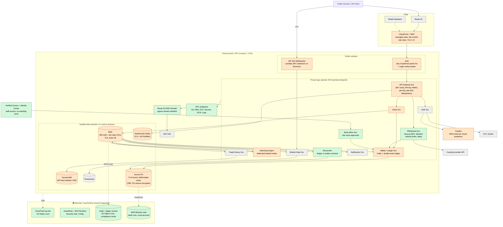
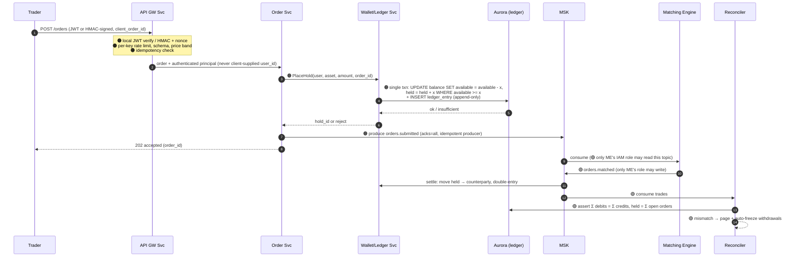

# Securing "Castle In The Cloud": the Trading Platform, Redesigned With Security Built In

This takes the Problem 1 architecture (AWS, EKS, MSK, Aurora, Redis, 500 req/s, p99 < 100 ms, ~19 ms order acknowledgement) and goes through it layer by layer. I did not add a security section at the end. I changed the design where it was unsafe, added controls where something was missing, and wrote down where I decided the existing risk was acceptable.

Every change is tagged:

| Tag | Meaning |
|---|---|
| 🟠 **CHANGED** | The original design was altered. Something in Problem 1 was wrong or unsafe. |
| 🟢 **ADDED** | A new component or control that was not there before. |
| ⚪ **ACCEPTED** | Reviewed and left as it was. The residual risk is stated. |
| 🔵 **DEFERRED** | Worth doing, but not before launch. The trigger to revisit is stated. |
| 🛑 **SHIP-BLOCKER** | I would refuse to go live without it. |

---

## 0. Start with what we're protecting

I ranked the assets before touching any component, because the ranking decides the priorities.

| # | Asset | Why it's ranked here | Worst realistic outcome |
|---|---|---|---|
| 1 | **Ledger integrity**: balances, holds, trades | An exchange that can't prove who owns what is insolvent, whatever the uptime says | Overdrafts, forged trades crediting an attacker, unprovable balances |
| 2 | **User accounts and withdrawal ability** | Account takeover is the most common way exchange users lose money | Credential stuffing, then a stolen API key or session, then a drained account |
| 3 | **KYC / PII** | Regulatory and reputational damage, and it can't be "rotated" after a leak | Passport scans leaked from an S3 bucket |
| 4 | **Order flow confidentiality** | Anyone who can read `orders.submitted` can front-run users | An insider or compromised service reading the order stream |
| 5 | **Availability of trading** | Matters, but an outage is recoverable. Items 1–3 often aren't | DDoS extortion during volatility |
| 6 | Public market data | Already public | Nothing worth protecting beyond availability |

**Threat actors I designed against:** external credential stuffers and bots; API-key thieves (malware on trader machines, keys leaked to GitHub); DDoS and extortion; a compromised dependency or CI pipeline; a **compromised pod inside the cluster**; and a malicious or compromised **insider with AWS or kubectl access**. The last two drove most of the design changes. The original design trusted everything inside the VPC.

---

## 1. Facts I don't have, and what I assumed

These would change the design. I'd get them in week one, and I'd proceed on the stated assumption until then.

| Unknown | Why it matters | How I'd get it | Assumption in the meantime |
|---|---|---|---|
| **Do we custody crypto (hold private keys)?** | If yes, key custody becomes asset #0 and dominates everything below (HSM/MPC, cold storage, withdrawal signing ceremonies) | Product / founders | **Custody is out of scope.** Problem 1 mentions hot/cold wallet separation but designs no blockchain integration. Wallets are internal ledger balances and deposits/withdrawals go through a custody provider's API. I flag it in §9. |
| **Regulatory jurisdiction** (MiCA, VARA, MAS, NYDFS…) | Drives KYC retention periods, data residency, audit log retention, pen-test cadence, and whether a SOC 2 / ISO 27001 is a launch requirement | Legal / compliance counsel | A strict regime: **7-year immutable retention** for trade and audit records, a single region (`us-east-1`), and a SOC 2 Type II within 12 months |
| **Expected users (MAU) and API-trader share** | Cognito advanced security is priced per MAU. Rate-limit design depends on the bot share. | Product / growth forecast | 50k MAU at launch; most order volume (≈80%) comes from API keys, not the UI |
| **KYC vendor and what data we store ourselves** | Determines whether we hold passport images or only a vendor reference. 🟠 Problem 1 puts KYC documents in S3. | Compliance + vendor contract | We use a vendor (e.g. Sumsub/Onfido-class) and store **only the verification result and a vendor reference**, plus a minimal PII record. Document images stay at the vendor. |
| **Team size / 24×7 coverage** | Determines whether alerts can page a human at 3 a.m. or must auto-contain | Engineering leadership | Small team, no in-house SOC. Detections must be **high-signal and few**, and high-confidence ones auto-contain (e.g. freeze withdrawals). |
| **Existing AWS Organization / identity provider** | Whether I'm building the account structure or fitting into one | Platform / IT | Greenfield. The company has Google Workspace or Entra ID as its workforce IdP. |
| **Risk appetite on availability vs. safety** | When in doubt, do we halt trading or keep going? | Leadership | **Fail closed on money movement** (withdrawals, ledger writes). Fail open only on read-only, public paths. |

---

## 2. The updated architecture

### 2.1 Topology, with changes marked



Legend: green = added, orange = changed, grey = reviewed and accepted.

### 2.2 Account structure 🟢 ADDED 🛑

Problem 1 implied a single AWS account. I split it up, because one account means one compromised admin credential reaches everything, including the logs that would show it happened.

```
AWS Organization (SCPs at the root)
├── Security         GuardDuty / Security Hub delegated admin, IAM Access Analyzer
├── Log Archive      CloudTrail org trail, VPC Flow Logs, audit archive (S3 Object Lock)
├── Backup           AWS Backup vault with Vault Lock (compliance mode)
├── Shared Services  ECR (images pushed only by CI), CI/CD OIDC roles
├── Prod             the platform
└── Staging          same shape as prod, synthetic data only, no prod data copies
```

**SCPs at the root:** deny disabling CloudTrail, GuardDuty or Config; deny leaving the Organization; deny all regions except `us-east-1` (and the DR region once it exists); deny root-user actions; deny `kms:ScheduleKeyDeletion` outside a break-glass role; deny creating IAM users and access keys.

**What it protects against:** an attacker or insider with prod-admin can't delete the audit trail or the backups, because those live in accounts prod-admin can't touch. This is the ransomware and "cover your tracks" defence.

---

## 3. Layer by layer: what changed and why

### 3.1 Edge

| Component | Tag | Change | Protects against |
|---|---|---|---|
| ALB origin | 🟠 CHANGED 🛑 | The ALB security group accepts only the **CloudFront managed prefix list**. CloudFront also injects a secret `X-Origin-Verify` header (rotated via Secrets Manager), and ALB listener rules drop requests without it. | **WAF bypass.** In the original design, anyone who discovered the ALB DNS name could skip CloudFront and WAF entirely. Of all the gaps, this one was the cheapest to close. |
| WAF | 🟠 CHANGED | WAF is attached at **CloudFront only**, so it is evaluated once at the edge. Added AWS managed rule groups (Core, Known Bad Inputs, IP reputation, **Account Takeover Prevention on `/auth/login`**, Bot Control on targeted paths). Rate-based rules per IP: 2,000 req / 5 min globally and 100 / 5 min on `/auth/*`. | Credential stuffing, scraping, volumetric L7 floods, commodity exploit scanners |
| TLS | 🟠 CHANGED | TLS 1.2+ only (`TLSv1.2_2021` policy), HSTS with preload, ACM certificates. **CloudFront to ALB is re-encrypted with TLS**. Problem 1 specifies TLS 1.3 at the edge but doesn't say the CloudFront-to-ALB hop is encrypted. | Downgrade attacks; plaintext on the CloudFront-to-origin hop |
| Shield | 🟠 CHANGED | Problem 1's diagram shows **Shield Advanced**, but its cost table doesn't include it (~$3,000/month, which would take the bill from ~$4k to ~$7k). I launch on **Shield Standard** (free) and defer Advanced. See §4. | L3/L4 floods are absorbed by CloudFront's footprint |
| Route 53 | ⚪ ACCEPTED + 🟢 | Unchanged, plus **DNSSEC signing** and registrar lock on the domain. | Domain hijack. Phishing clones of exchanges are a real attack, and a hijacked domain is worse. |

**Why rate limiting lives in two places:** WAF rate rules key on IP and run over 5-minute windows, which is too coarse for a trading API where one institutional client legitimately sends 50 req/s from one IP. So WAF stops the floods, and the **API Gateway Service applies per-user and per-API-key token buckets in Redis** (see 3.2). Each layer does the job the other can't.

### 3.2 Identity and the API layer

This is where account takeover happens, so it's where most of the user-facing work went.

**Users (browser): Cognito** 🟠 CHANGED

- 🛑 **MFA required** for every account. TOTP or WebAuthn/passkeys. **SMS is not offered as a factor** (SIM-swap is a known attack against exchange users).
- Cognito **threat protection** (compromised-credential check, adaptive auth) in enforce mode.
- Access tokens last 15 minutes. Refresh tokens last 7 days, are rotated on use, and are revoked on password change, MFA change or "log out all devices."
- ⚪ Kept from Problem 1: the Gateway **verifies JWT signatures locally** against the cached JWKS. 🟠 But Problem 1 also lists Redis as a "JWT session store". If a session record in Redis can make a request valid, Redis becomes a trust anchor: anyone who can write to it can mint sessions. Redis now holds only a **revocation denylist** (by `jti`) and is never a source of "this token is valid."

**API clients: API keys** 🟠 CHANGED 🛑

Problem 1 already validates HMAC-SHA256 signatures and keeps API-key metadata in DynamoDB, but doesn't say how secrets are stored, how replay is stopped, or what a key is allowed to do. API-key traders send ~80% of volume (assumed) and are the main target of key theft. The changes:

- Keys are `key_id` + secret. The secret is shown **once**, and only an **HMAC-SHA256 of it** is stored, encrypted under a dedicated KMS CMK.
- Every request is **signed**: `HMAC(secret, method + path + body_hash + timestamp + nonce)`. The timestamp must fall within ±5 s and the nonce is checked against Redis with a 10 s TTL. **This blocks replay** of captured requests.
- Keys carry **scopes**: `read`, `trade`, `withdraw`. **`withdraw` scope is off by default** and needs an IP allowlist to enable. A stolen trade-only key can lose a user money through bad trades but **cannot move funds out**. That alone removes the most common exchange-loss path.
- Creating a key, or changing its scopes or IP list, requires step-up MFA and sends an email notification plus a 24-hour hold before `withdraw` scope becomes active.

**Other API Gateway Service controls** 🟠 CHANGED

- ⚪ Kept from Problem 1: **idempotency keys** (`client_order_id`). I make them **mandatory** and deduplicated per user for 24 h, which stops double submission from retries and replay.
- **Strict schema validation** at the edge of the service: decimal precision, symbol allowlist, price bands (orders more than X% from last trade are rejected). Price bands protect users from fat-finger trades and from stolen keys used to dump assets at absurd prices into an attacker's matching order.
- **Rate-limit failure mode:** if Redis is unavailable, the Gateway falls back to a **local in-pod limiter** (conservative per-pod quotas). Orders are not left unlimited. This is fail-safe, not fail-open.

**WebSocket** 🟠 CHANGED

- Problem 1 uses a hybrid: public streams go through ALB/NLB to Market Data pods, and private notifications through API Gateway WebSocket. Neither path says how a connection is authenticated. Private connections now need a **Cognito JWT (or signed API-key handshake) at connect time**: a Lambda authorizer on `$connect` for API Gateway, and token verification in the Market Data pod's upgrade handler for the NLB path.
- **Public channels** (order book, trades) are unauthenticated by design. ⚪ ACCEPTED, since the data is public. They are protected by a per-IP connection cap.
- **Private channels** (my orders, my fills, my balances) are authorized **server-side**. The connection-to-user mapping is stored at `$connect`. The Market Data/Notification service looks up the recipient's `connectionId` and never accepts a client-supplied user ID. This prevents one user subscribing to another user's fills (classic IDOR).

### 3.3 The order and money path: the most important change 🟠 CHANGED 🛑

**What Problem 1 gets right, and where it still leaks:** Problem 1 correctly reserves funds *before* the order is published, with an atomic Redis Lua script (`available -= x; reserved += x`). That closes the naive check-then-debit race. But the reservation lives **only in ElastiCache**, and ElastiCache replicates **asynchronously**. If the primary fails after acknowledging a reservation but before the replica has it, the promoted replica shows the funds as available again. The same 100 USDT can then be reserved twice. Problem 1 claims Redis RPO = 0 because it is "ledger-backed", but the Aurora ledger only records *settlements*, not reservations, so the rebuild has to work out open orders from Kafka while new orders keep arriving. Redis and Aurora are two sources of truth for one balance. An attacker who can trigger or simply wait for a failover (a cache node fails every few months at this scale) gets free credit. Strictly it's an integrity bug rather than a "security feature" gap, which is why it belongs in the architecture and not in a security appendix.

**Options I weighed:** (a) **MemoryDB** keeps Redis semantics and Lua but commits to a multi-AZ transaction log before acknowledging (~2–4 ms writes). (b) **The hold in Aurora**, in the same database as the ledger. I chose (b): one source of truth, the hold and the ledger entry in one transaction, and Postgres grants to make the ledger append-only. MemoryDB is the fallback if Aurora write latency under load turns out too high.

**The redesign:**



What each piece buys:

1. **Atomic hold in Aurora** 🟠 (moved from Redis). The conditional `UPDATE … WHERE available >= x` makes overdraft impossible by construction, and Aurora acknowledges only after a 4-of-6 quorum write across 3 AZs, so a failover can't forget a hold. Redis can still cache *display* balances but is never consulted for a money decision.
2. **Append-only double-entry ledger.** Balances are a materialised projection of ledger entries. The application's DB role has `INSERT` on `ledger_entries` but **no `UPDATE`/`DELETE`** (enforced with Postgres grants, not convention). Corrections are new compensating entries. A compromised Wallet pod can't silently rewrite history.
3. ⚪ **Kept from Problem 1: `acks=all` + `min.insync.replicas=2` + idempotent producers + unclean leader election off.** This is right and stays. Without it, an order acknowledged to the user could be lost while its funds stay held.
4. **Reconciler** 🟢. A small service that continuously checks the invariants: ledger sums to zero per asset; `held` equals the sum of open orders; every `orders.matched` event has exactly one settlement. **This is the detection control for everything I can't prevent**, including a forged Kafka message, a bug, or an insider with DB access. On mismatch it pages and automatically **freezes withdrawals** (not trading), so it stops money leaving without taking the exchange down.

### 3.4 Kafka (MSK): the internal trust boundary 🟠 CHANGED 🛑

Problem 1 makes Kafka durable (`acks=all`, RF 3) but says nothing about who may read or write it. It is the **source of truth the matching engine rebuilds from**, and `orders.matched` is effectively a command to move money. In the original design any pod that could reach the brokers could publish a fake match and get the Wallet to credit it.

| Control | Detail |
|---|---|
| **AuthN** | MSK **IAM authentication**. Each service has its own EKS Pod Identity / IRSA role. Unauthenticated listeners and plaintext listeners are disabled. |
| **AuthZ: producers** | `orders.submitted`: Order Svc only. `orders.matched`, `orders.cancelled`, `market.*`: **Matching Engine only.** `wallet.transactions`: Wallet only. |
| **AuthZ: consumers** | `orders.submitted`: **Matching Engine only.** This is the front-running control (asset #4). Trade History and Market Data get `orders.matched`/`market.*`, never the raw submitted stream. |
| **Admin** | Topic create/delete/alter-config is granted to the deployment pipeline role only. No human holds it standing. Deleting `orders.*` would destroy the matching engine's recovery log. |
| **Encryption** | TLS in transit (client-broker and broker-broker), CMK at rest. |
| **Retention** | `orders.*` keeps 7 days in-cluster plus **matching-engine snapshots every N minutes to S3**. Replay starts from snapshot + offset, not from the beginning of time. A tiered copy of every financial topic goes to the **Object-Locked audit bucket** in the Log Archive account. |

🔵 **DEFERRED: per-message signatures** (the Matching Engine signs each `orders.matched` with a KMS key and the Wallet verifies). It would close the remaining gap where an attacker obtains the Matching Engine's own role. I deferred it because the ACLs plus the Reconciler already catch that case, and KMS `Sign` per message is ~5–10 ms, which would need batching or a local key to stay in budget. Revisit if we move to dedicated matching hosts (Phase 2), where a local HSM-backed key is natural.

### 3.5 Compute (EKS)

| Area | Tag | Change | Protects against |
|---|---|---|---|
| Cluster endpoint | 🟠 CHANGED 🛑 | **Private API endpoint only.** `kubectl` access goes through IAM Identity Center into EKS access entries. Default staff role is read-only. Write access is a time-boxed elevation with approval and a reason, and it's logged. | Internet exposure of the K8s API; standing admin access |
| Workload identity | ⚪ kept + 🟢 ADDED 🛑 | Problem 1 already uses **one IAM role per service** (IRSA / Pod Identity). Added: the node instance role keeps only what nodes need, and **IMDSv2 with hop limit 1**, so pods can't bypass their own role by stealing node credentials. | A single compromised pod inheriting every service's permissions |
| Network policy | 🟢 ADDED | **Default-deny** NetworkPolicies per namespace (VPC CNI network policy engine). Explicit allows that follow the call graph: GW→OS→Wallet, nothing reaches Wallet except OS, WD, Back-office and Kafka consumers. | Lateral movement from a compromised, internet-facing pod |
| Pod security | 🟢 ADDED | Pod Security Standard **`restricted`**: non-root, read-only root FS, no privilege escalation, dropped capabilities, seccomp `RuntimeDefault`. | Container escape; persistence inside containers |
| Matching Engine placement | 🟠 CHANGED | **Dedicated tainted node group**, no co-tenancy with internet-facing pods. | Noisy-neighbour latency, *and* a compromised GW pod on the same node reaching ME memory via a kernel escape |
| Supply chain | 🟢 ADDED 🛑 | CI uses **GitHub OIDC to AWS** (no long-lived keys). Images built from pinned, minimal (distroless) bases, scanned (ECR enhanced scanning / Inspector), **signed (cosign / AWS Signer)**. An admission policy (Kyverno) **rejects unsigned images or images not from our ECR**. SBOM stored per release. | Compromised dependency or registry; someone running `kubectl run` with an arbitrary image in prod |
| Secrets | 🟠 CHANGED | Secrets Manager delivered via **External Secrets / CSI driver** as mounted files, not env vars baked into manifests. Etcd envelope encryption with a CMK. | Secrets leaking via `kubectl describe`, crash dumps or a Git history |
| Runtime detection | 🟢 ADDED | **GuardDuty EKS Runtime Monitoring.** | Crypto-miners, reverse shells, unexpected binaries in containers |

### 3.6 Network

| Component | Tag | Change | Protects against |
|---|---|---|---|
| Subnet tiers | 🟠 CHANGED 🛑 | Three tiers. **Public:** ALB, NAT only. **Private app:** EKS nodes. **Isolated data:** MSK, Aurora, Redis, with **no route to a NAT or IGW at all**. Security groups reference each other (e.g. Aurora accepts 5432 only from the Wallet SG and Reconciler SG). | Data stores being reachable from anywhere they don't need to be; data exfiltration straight from the data tier |
| VPC endpoints | ⚪ kept + 🟢 ADDED | Problem 1 already has gateway endpoints for S3/DynamoDB. Added: interface endpoints for KMS, STS, Secrets Manager, ECR, CloudWatch Logs. **Endpoint policies + bucket policies with `aws:SourceVpce`**, so our buckets can't be read from outside our VPC even with valid stolen credentials. | Credential theft leading to exfil from a laptop; AWS API traffic over the internet |
| Egress | 🟢 ADDED | **Route 53 Resolver DNS Firewall** with an allowlist of the domains we actually call (KYC vendor, custody API, push providers, package mirrors at build time only). Everything else gets NXDOMAIN and an alert. | Command-and-control callbacks and DNS-based exfil from a compromised pod |
| | 🔵 DEFERRED | **AWS Network Firewall** (SNI filtering, IPS). DNS Firewall covers most of the value at ~10% of the cost. Network Firewall is ~$300/month per AZ endpoint plus data processing. Revisit when compliance demands IPS or we see IP-literal egress in flow logs. | |
| VPC Flow Logs | 🟢 ADDED | To the Log Archive account. | Forensics after the fact |

### 3.7 Data

| Store | Tag | Change | Protects against |
|---|---|---|---|
| **Aurora** | 🟠 CHANGED 🛑 | `rds.force_ssl=1`. Credentials from **Secrets Manager with 30-day rotation** (or IAM DB auth for the Reconciler, which connects rarely). **Per-service DB roles**: Wallet can `INSERT` ledger rows but not `UPDATE`/`DELETE`; Trade History gets read-only on a reporting replica. CMK per data domain. Deletion protection on. | Credential reuse; a compromised service rewriting history; snapshot exfil with AWS-managed keys |
| PII columns | 🟢 ADDED | Name, DOB, address, document number are **encrypted at the application layer** (envelope encryption, KMS data key per tenant batch) so that DB admins, read replicas and snapshot restores see ciphertext. Only Auth/KYC and Back-office roles hold `kms:Decrypt` on that key. | Insider or backup-based PII exposure; a reporting replica leaking PII |
| **DynamoDB** | 🟠 CHANGED | API keys stored as HMACs (see 3.2). CMK encryption. PITR on. Fine-grained IAM: only the Gateway role can read the API-key table. | Leaked table = leaked keys (now it doesn't) |
| **Redis** | 🟠 CHANGED | In-transit encryption + **Redis RBAC users per service**. Demoted from trust anchor to cache, revocation list and rate counters (see 3.2, 3.3). | Session forgery via Redis writes; plaintext session data on the wire |
| **S3** | 🟠 CHANGED | Block Public Access at the **account** level. Separate buckets (and keys) for SPA assets, reports, backups and audit. SPA bucket is reachable only through CloudFront **OAC**. Trade report exports use **short-lived presigned URLs** (5 min) scoped to the requesting user's prefix. | Public bucket incidents; one user downloading another's statements |
| **Timestream** | ⚪ ACCEPTED | OHLCV candles are derived from public trades. Default encryption, no CMK. | Nothing material: the data is public |
| **Backups** | 🟢 ADDED 🛑 | AWS Backup copies Aurora and DynamoDB to the **Backup account** with **Vault Lock (compliance mode)**, 35-day minimum. **Restore is tested quarterly.** A backup that's never been restored is a hope, not a control. | Ransomware or a malicious admin deleting prod *and* its backups |

**KMS key design** 🟠 CHANGED: Problem 1 uses KMS envelope encryption for PII and wallet state but doesn't say which keys or who can use them. I use **separate CMKs per data domain** (ledger, PII, API keys, logs, backups) so that a key policy decides who can read what. The PII key can be denied to everything except two roles, which an AWS-managed key cannot do. Key deletion is blocked by SCP.

⚪ **ACCEPTED: CloudHSM.** I agree with Problem 1 that it's overkill for *this* design. KMS is FIPS 140-2 Level 3 validated. **That judgement flips if custody is in scope** (see §1): signing withdrawal transactions is exactly what dedicated HSMs or MPC are for.

### 3.8 Withdrawals 🟢 ADDED 🛑

Problem 1 mentions withdrawal whitelists and hot/cold wallet separation, but never designs the withdrawal flow itself. That's the moment every account takeover is aiming for, so it gets its own service with its own controls.

- **Step-up MFA** on every withdrawal, required to be fresh (≤ 5 min), regardless of session age.
- **Address allowlist.** New withdrawal addresses have a **24-hour cooldown** plus an email confirmation link. Password, MFA or email changes **lock withdrawals for 24 h**.
- **Velocity limits** per user per 24 h, tied to KYC tier. Amounts over a threshold go to **manual review** in the Back-office.
- **Delay queue.** Withdrawals settle after a short delay (e.g. 10 min). During that window the Reconciler and anomaly rules (new device + new IP + full balance) can cancel them. The delay is the cheapest fraud control available.
- **Global kill switch** (a feature flag the Reconciler can trip) that pauses withdrawals platform-wide without halting trading.
- The Withdrawal Svc is the **only** workload with egress to the custody provider (NetworkPolicy + DNS Firewall), and it holds the custody API credential alone.

### 3.9 Staff access and the Back-office 🟢 ADDED

An exchange needs humans who can freeze accounts, review KYC, and correct balances. Problem 1 didn't have this, and in practice teams end up using `psql` against prod for it, which is the riskiest outcome.

- A **Back-office service** behind **AWS Verified Access** (identity- and device-aware, not exposed publicly), authenticated through the workforce IdP with phishing-resistant MFA.
- **Four-eyes approval** on any balance adjustment or withdrawal-limit override: one person proposes, a different person approves, and both are written to the ledger as the reason for the compensating entry.
- **No standing prod access.** AWS console access is via IAM Identity Center with time-boxed elevation. A **break-glass role** exists, alarms when used, and its credentials are in a sealed process (two holders).
- **Direct DB access** in prod is read-only through a bastion-less path (SSM Session Manager port forwarding), with session logging. Write access is break-glass only.

### 3.10 Notifications ⚪ ACCEPTED with one change

- Event-driven fan-out via SNS→SQS stays as designed.
- 🟠 **SMS is capped** (spend limit, per-user and per-country rate) and used only for low-value alerts. That guards against SMS-pumping/toll fraud, where attackers trigger SMS to premium numbers to bill us, and is consistent with not using SMS as an auth factor.
- Notification content **never includes full balances or one-time codes in push or SMS previews**, because those show up on lock screens.

### 3.11 Logging, detection and response

| Item | Tag | Detail |
|---|---|---|
| CloudTrail org trail | 🟢 🛑 | All accounts, management and data events for the PII/audit buckets and KMS keys. Lands in Log Archive with **Object Lock**. |
| App audit log | 🟢 🛑 | Every auth event, key creation/scope change, withdrawal request, admin action and ledger write, as structured events with principal, source IP and request ID. **Copied to the Object-Locked archive.** Retention 7 years (assumed regime, §1). |
| Log hygiene | 🟢 | The OpenTelemetry Collector **redacts** `Authorization` headers, API secrets, signatures and PII fields before export. Traces were in Problem 1. Without redaction they'd be a credential store. |
| GuardDuty + Security Hub + Config | 🟢 | Delegated to the Security account. Config conformance pack (CIS / AWS Foundational Security Best Practices). |
| **High-signal detections** (few, by design) | 🟢 | 1) Reconciler invariant break. 2) Root or break-glass use. 3) CloudTrail/GuardDuty tamper attempts (blocked by SCP, but still alerted). 4) Withdrawal anomaly: new device + new address + more than 80% of balance. 5) DNS Firewall block from a prod workload. 6) Spike in failed HMAC signatures for one key (stolen key being probed). |
| Auto-containment | 🟢 | Detection 1 freezes withdrawals. Detection 4 holds the withdrawal for review. Detection 6 disables the key and notifies the user. Everything else pages. Built for a small team with no SOC (§1). |

### 3.12 Does the security still fit the latency budget?

The p99 < 100 ms requirement is non-negotiable, so I re-did the budget with every security change on the synchronous path:

| Segment | Problem 1 | Secured | What's new on the path |
|---|---|---|---|
| CloudFront (+WAF) → ALB | ~5 ms | ~6 ms | WAF evaluated once at the edge, origin-verify header, TLS re-encryption with keep-alive |
| ALB → API GW Svc | ~1.5 ms | ~1.5 ms | — |
| AuthN + rate limit | ~1 ms | ~1.5 ms | Adds nonce + revocation check, pipelined into the same Redis round-trip over TLS |
| Validation + balance reservation | ~2.5 ms (Redis Lua) | ~5 ms (Aurora hold) | 🟠 Conditional UPDATE + ledger INSERT in one txn, writer in same AZ via RDS Proxy |
| Kafka produce | ~8 ms (acks=all) | ~8 ms | Unchanged |
| Response | ~1 ms | ~1 ms | — |
| **API ack total** | **~19 ms** | **~23 ms** | **Still ~4× headroom under 100 ms** |

These are design estimates. I'd confirm them with a k6 load test at 2× target load in staging before launch, and keep a **p99 SLO alarm** on the order endpoint so security changes that add latency show up the day they ship.

---

## 4. Priorities: what I secure first

### 🛑 Refuse to ship without (launch blockers)

I'd hold a launch date for any of these. Each one either protects money directly or is the only way we'd ever find out we'd been robbed.

1. **Atomic balance holds + append-only ledger + Reconciler** (3.3). Without them the exchange can overdraft, and nobody would notice.
2. **Kafka IAM auth + per-topic ACLs** (3.4), keeping Problem 1's `acks=all`. Otherwise any pod can forge trades.
3. **Withdrawal controls**: step-up MFA, allowlist + cooldown, velocity limits, delay, kill switch (3.8).
4. **MFA for all users (no SMS) + signed, scoped API keys with `withdraw` off by default** (3.2).
5. **No WAF bypass**: ALB reachable only from CloudFront (3.1).
6. **Multi-account + SCPs + Object-Locked CloudTrail and audit logs + Vault-Locked cross-account backups with a tested restore** (2.2, 3.7, 3.11).
7. **Private data tier, private EKS endpoint, per-service IAM roles, IMDSv2 hop limit 1** (3.5, 3.6).
8. **No long-lived credentials anywhere**: CI via OIDC, staff via Identity Center, DB creds rotated (3.5, 3.9).
9. **TLS on every hop that carries money or credentials**: edge, ALB, Aurora, Redis, MSK.
10. **An external penetration test** of the order, auth and withdrawal paths, with criticals fixed.

### First 90 days after launch

- Tune default-deny NetworkPolicies from "allow-namespace" to per-service (start broader at launch to avoid outages, then tighten using flow-log evidence).
- Turn the Kyverno image-signature policy from *audit* to *enforce* once every image is signed (it's in audit mode on day one so a missed signature can't block an emergency fix).
- Security Hub findings triaged to zero criticals; Config conformance pack green.
- Public **bug bounty** (users of exchanges actively look for bugs; better they report them to us).
- Tabletop exercise: "stolen API key with `trade` scope" and "insider with prod DB read."

### 🔵 Deferred, with the trigger to revisit

| Deferred | Why not now | Revisit when |
|---|---|---|
| **Shield Advanced** (~$3,000/month + data fees) | Shown in Problem 1's diagram but missing from its cost table. It would nearly **double** the ~$4k/month infrastructure cost. CloudFront + WAF rate rules + Shield Standard cover the L7 and L3/4 floods we're likely to see at this size. | First serious DDoS, an extortion attempt, or when revenue makes a few hours of downtime cost more than $36k/year. Shield Advanced's DDoS cost protection and the response team become worth it then. |
| **Service mesh mTLS** (Istio / App Mesh) | Adds a sidecar hop (~1–3 ms p99 per call, several calls per order) and significant operational load for a small team. Pod-to-pod traffic in the VPC is protected by NetworkPolicy, per-service identity on every *data* hop (Kafka, Aurora, Redis all use TLS + per-service auth), and the Nitro automatic in-transit encryption on supported instance families. I'd **pick node instance types that support it** (verify against AWS's current list). | We need service-level authorization between HTTP services beyond what the propagated user JWT gives us, or a regulator asks for explicit mTLS. |
| **Kafka message signing** | See 3.4. The Reconciler detects what it would prevent. | Phase 2 dedicated matching hosts. |
| **Network Firewall** | See 3.6. DNS Firewall gives most of the value. | Compliance requires IPS, or we see IP-literal egress. |
| **Macie** on S3 | Problem 1 stores KYC documents in S3. I change that (see §1) so the vendor keeps the images, which leaves little for Macie to find. | If compliance requires us to hold document images after all. |
| **Multi-region DR** | Availability concern, and Problem 1 already phases it in. Security impact is addressed by the cross-account backups. | Problem 1 Phase 3, or a regulatory RTO requirement. |
| **CloudHSM / MPC** | KMS is sufficient for data encryption. | **Immediately** if custody turns out to be in scope (see §9). |

---

## 5. Where I deliberately accepted the risk

These are conscious decisions, not oversights:

| Accepted | Residual risk | Why it's acceptable |
|---|---|---|
| **Public market data is unauthenticated** | Scraping; competitors consuming our feed | The data is public by nature. Per-IP connection caps limit the cost. Auth would add friction for no confidentiality gain. |
| **Single region** | A regional outage takes trading down | An availability risk, not a confidentiality or integrity one. Ledger integrity survives via the cross-account backups. |
| **Redis is still on the order hot path** (rate limits, nonces, idempotency) | If Redis is degraded, rate limiting becomes less precise | It no longer decides anything about money or identity validity. Failure falls back to conservative local limits, not to "no limits." |
| **Timestream on AWS-owned keys** | AWS-side compromise could expose candles | Candles are derived from public trades. |
| **Timestamp window of ±5 s on signed requests** | Clients with clock drift get rejected; the nonce cache is a Redis dependency | The nonce cache blocks replay inside the window, and the window blocks replay outside it. Drifting clients get a clear error and a server-time endpoint to sync from. |
| **WebSocket API Gateway stays managed** (not self-hosted on EKS) | AWS service limits and less control over the TLS stack | The managed service removes a large class of connection-handling bugs; we only lose control we didn't need. |
| **Staging mirrors prod but is less locked down** (no Verified Access, broader staff access) | A compromise of staging | Staging holds **synthetic data only**, enforced by policy: no prod snapshots restored to staging. It's in a separate account, so there's no network path to prod. |

---

## 6. Cost of the changes (rough)

| Item | Est. monthly |
|---|---|
| GuardDuty (incl. EKS runtime) + Security Hub + Config | ~$250–400 |
| Cognito threat protection (assumed 50k MAU) | ~$500–1,000 (per-MAU; the biggest unknown here) |
| WAF bot control + ATP managed rules | ~$100–200 + per-request fees |
| VPC interface endpoints (6 × 3 AZs) | ~$130 |
| Extra CMKs, Secrets, DNS Firewall, Verified Access, Backup copies, log archive | ~$200–350 |
| **Total security delta** | **~$1,200–2,100 / month** on top of Problem 1's ~$4,000 on-demand (~$3,000 with commitments) |

The Cognito per-MAU price is the biggest uncertainty, and it's why the MAU forecast is in §1. If it comes in high, the fallback is enforcing MFA plus WAF ATP (cheaper) and enabling Cognito threat protection only on accounts above a balance threshold.

---

## 7. How this would be verified

A design claim is only worth something if it's tested:

- **Infrastructure as code** (Terraform) with **policy-as-code** in CI (Checkov / OPA). Public S3, an open security group on 5432, or an unencrypted MSK cluster **fails the build**. That stops drift from undoing the design.
- **Abuse-case tests** in the CI suite: concurrent order flood against a small balance (must never go negative); replayed HMAC request (must 401); private-channel subscription with another user's ID (must be denied); `withdraw` with a `trade`-scoped key (must 403).
- **Chaos plus security**: kill the Redis primary during a load test and confirm rate limiting degrades to local limits, not off.
- **Quarterly** restore test from the Vault-Locked backups into an isolated account; **annual** external pen test; a continuous bug bounty.

---

## 8. Summary of what changed from Problem 1

| Problem 1 said | Now |
|---|---|
| Atomic reservation in Redis (Lua), async-replicated | **Hold in Aurora**, same transaction as an append-only ledger entry; Reconciler |
| Kafka `acks=all`, no auth mentioned | Kept `acks=all`; added IAM auth and **per-topic producer/consumer ACLs** |
| Local JWT verify, but Redis as "JWT session store" | Redis is only a revocation list |
| HMAC-signed API keys, storage and scope undefined | Secrets stored as HMACs; nonce replay guard; scoped; `withdraw` off by default |
| WAF + Shield Advanced (uncosted) | WAF on CloudFront, Shield Standard; **ALB unreachable except from CloudFront** |
| WebSocket auth not specified | Token checked at connect; server-side authorization of private channels |
| One account (implied) | Organization with Security, Log Archive, Backup and Shared accounts; SCPs |
| KMS envelope encryption, keys unspecified | Per-domain CMKs; PII column encryption; key deletion blocked |
| Withdrawal whitelists mentioned, no flow | Withdrawal Svc: step-up MFA, allowlist + cooldown, velocity, delay, kill switch |
| No staff/admin design | Back-office behind Verified Access, four-eyes, no standing prod access |
| Observability only | Plus immutable audit trail, GuardDuty, six high-signal detections with auto-containment |

---

## 9. The one assumption that would change everything

If the exchange **holds customers' crypto private keys**, this document covers the platform but not the most valuable asset. I'd then add, before anything in §4: hot/cold wallet split, with most funds in cold storage under an offline signing ceremony; **MPC or CloudHSM-backed signing** for the hot wallet with per-transaction policy (limits, allowlisted destinations) enforced *inside* the signer; the Withdrawal Svc reduced to *requesting* signatures, never holding keys; and proof-of-reserves. That's the first question I'd ask on day one.
